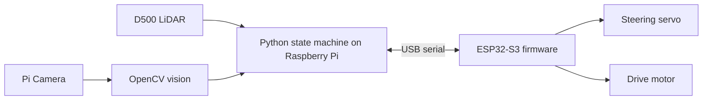

# WRO 2026 Autonomous Car

An autonomous car for the World Robot Olympiad (WRO) Future Engineers challenge. The system combines a Raspberry Pi 4B, Pi Camera, D500 LiDAR, and ESP32-S3 to perceive the track and control steering and drive motors.


## System overview



## Results

| Metric | Result |
| --- | --- |
| Vision processing rate | 28+ FPS reported in the engineering journal |
| Lap time | Not measured yet |
| Run success rate | Not measured yet |

Race performance is not yet benchmarked. Lap time and success rate should be added after repeated, timed track runs.

## Hardware and software

- Raspberry Pi 4B running Python 3
- D500 360° LiDAR over serial
- Raspberry Pi Camera with OpenCV color detection
- ESP32-S3 actuator controller with C++ firmware
- Python control, calibration, and visualization utilities

See [mechanical design](docs/mechanical-design.md), [power and sensor architecture](docs/power-sensor-architecture.md), [software architecture](docs/software-architecture.md), and [engineering journal](docs/engineering-journal.md).

## Team

- **Bashar Ghosheh** — project owner and developer

## Setup

### Raspberry Pi

```bash
git clone https://github.com/bashar-ghosheh/wro-2026-autonomous-car.git
cd wro-2026-autonomous-car
python3 -m venv .venv
source .venv/bin/activate
pip install -r requirements.txt
```

Picamera2 uses Raspberry Pi OS camera libraries. Install the OS packages if needed:

```bash
sudo apt update
sudo apt install -y python3-picamera2
```

### ESP32-S3

Open the Arduino IDE, select the **ESP32S3 Dev Module**, and upload `firmware/esp32_firmware/esp32_firmware.ino`.

### Run

Connect the LiDAR and ESP32 to the Pi, then run:

```bash
python3 main.py
```

For camera and LiDAR tuning tools, see the scripts under `calibration/`.

## Configuration and network access

Set the ESP32 calibration access point password in the firmware configuration before flashing. Do not commit real credentials. The live calibration pages use the Raspberry Pi hostname on the local network, for example `http://<pi-hostname>.local:8000` for the camera tuner and port `8001` for the LiDAR plot.

## WRO rules

Use the [official WRO 2026 season page](https://wro-association.org/competition/2026-season/) for current Future Engineers rules, documentation rubric, and local organizer guidance. National organizers may publish adapted rules.

## Version

Project version: **1.0**. See the [v1.0 release](https://github.com/bashar-ghosheh/wro-2026-autonomous-car/releases/tag/v1.0).

Repository layout: [docs/structure.txt](docs/structure.txt).

Wiring references: [ESP32-S3 pinout](docs/ESP32-V3-pinout.webp) · [Raspberry Pi GPIO pinout](docs/rpi4b-gpio.webp).

